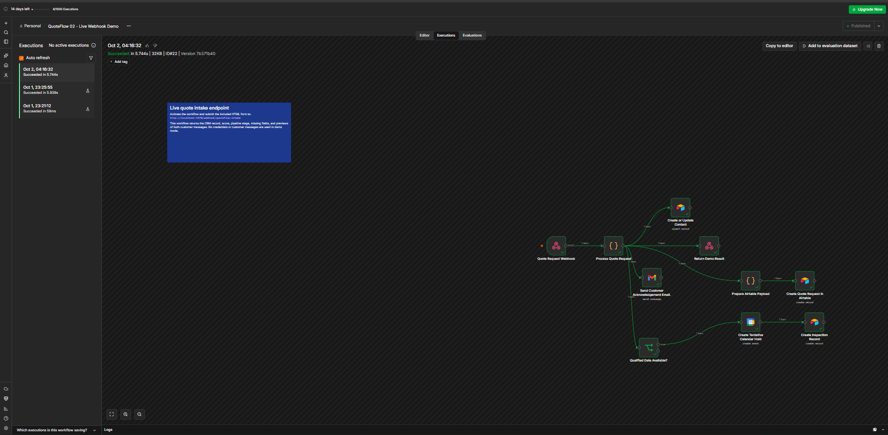
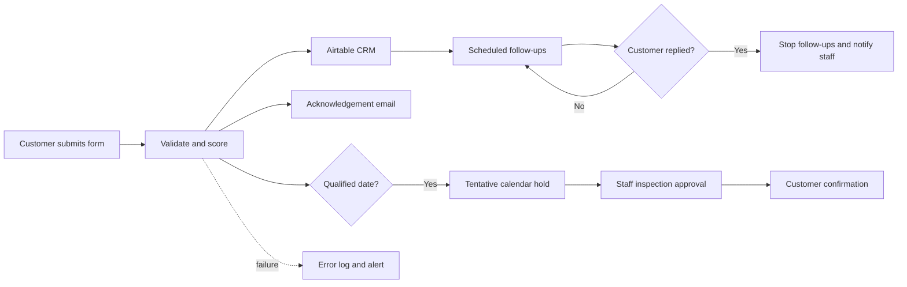
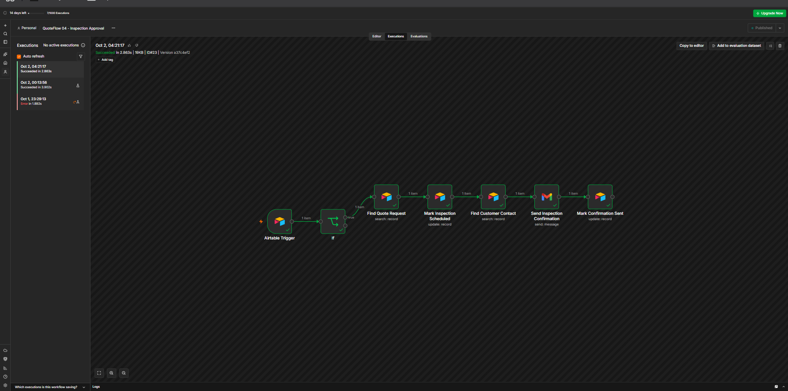
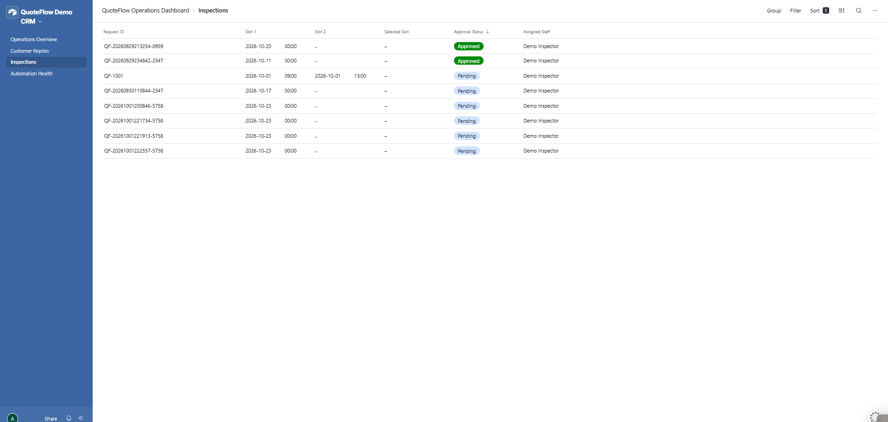

# QuoteFlow

**QuoteFlow** is an end-to-end quote-intake and follow-up automation demo for cleaning companies. It connects a customer-facing form to n8n, Airtable, Gmail and Google Calendar so a small service business can respond faster without losing human control of inspections and pricing decisions.



> This repository is a portfolio demonstration built with fictional customer data. It is not a claim about results achieved for an existing client.

## What it automates

- Captures and validates quote requests
- Detects missing customer or job information
- Scores and prioritizes leads transparently
- Creates or updates Airtable CRM records
- Prepares and sends acknowledgement emails
- Creates tentative inspection calendar holds
- Routes inspection approval to staff
- Sends scheduled follow-ups with stop conditions
- Detects customer replies and prevents duplicate handling
- Logs communications and workflow failures
- Alerts staff when an automation needs attention

## Human-in-the-loop design

QuoteFlow automates the administration around a cleaning quote, not the judgment required to price an unusual job. Staff can inspect the property, confirm the true scope and approve any pricing exception before a final quote is issued.

## End-to-end journey



## Repository structure

```text
airtable-import/   Fictional CSV templates for the Airtable base
demo-form/         Customer-facing HTML form
docs/              Architecture, setup guide and evidence screenshots
scripts/           Public-export validation tooling
workflows/         Sanitized n8n workflow exports
```

## Workflow set

| Workflow | Purpose |
|---|---|
| 01 – Core Demo | Normalizes, validates and scores a fictional request |
| 02 – Live Webhook | Receives the form, writes CRM records and prepares next actions |
| 03 – Follow-Up Demo | Demonstrates follow-up eligibility and stop conditions |
| 04 – Inspection Approval | Converts staff approval into a scheduled inspection and confirmation |
| 05 – Scheduled Follow-Ups | Finds due requests, sends follow-ups and updates state |
| 06 – Customer Reply Handler | Matches replies, stops future follow-ups and alerts staff |
| 07 – Automation Error Monitor | Records failures and emails an actionable alert |

## Quick start

1. Import the CSV files in `airtable-import/` into a new Airtable base.
2. Import the JSON files in `workflows/` into n8n.
3. Configure your own Airtable, Gmail and Google Calendar credentials.
4. Replace the placeholder Airtable base/table IDs and notification addresses.
5. Publish the live webhook workflow.
6. Set the webhook URL in `demo-form/index.html`, then open the form in a browser.

See [the complete setup guide](docs/SETUP.md) before enabling any message-sending nodes.

## Evidence

### Live intake orchestration


### Staff-controlled inspection approval



### Airtable operations dashboard



## Safety notes

- The repository contains no API keys, OAuth tokens or credential objects.
- The included customer rows are fictional.
- Imported workflows are inactive and require you to supply your own credentials.
- Keep a demo-mode guard in place while testing email or WhatsApp delivery.
- Never use production customer data in a public repository.

## Technology

- n8n Cloud
- Airtable
- Gmail OAuth2
- Google Calendar
- HTML, CSS and JavaScript

